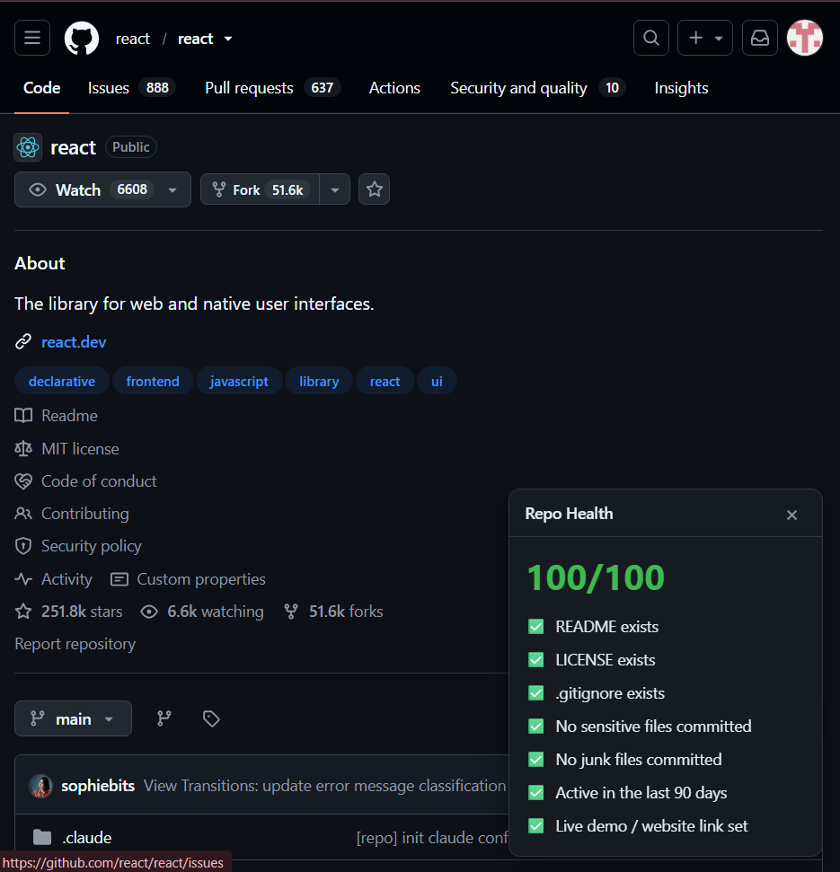
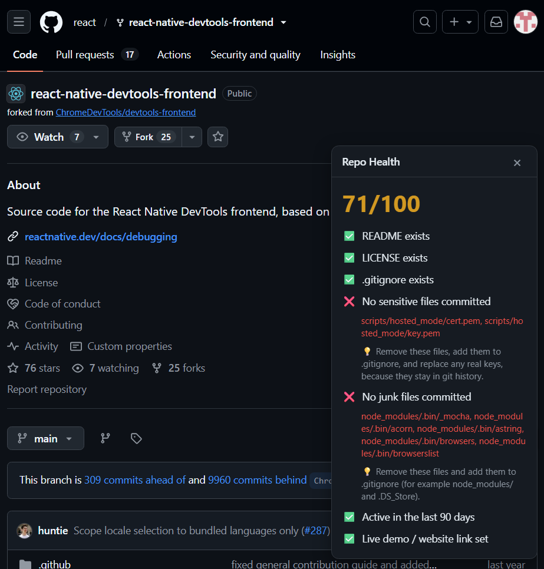

# Repo Health Panel

A Chrome extension that shows a quick health score for any public GitHub repository, right on the repo page.

Open a repo like github.com/facebook/react and a small panel appears in the bottom-right corner with a score out of 100 and a checklist of what is good and what is missing.
Every failed check also shows a short how-to-fix tip, so the panel works as a to-do list for improving a repo, not only a scoreboard.

## Screenshots

A healthy repo (github.com/react/react):

A repo with problems. Committed node_modules and key files are listed by name, with a tip for each failed check:

## What it checks (7 checks)

- README exists
- LICENSE exists
- .gitignore exists
- No sensitive files committed (.env files, .pem / .p12 / .pfx keys, id_rsa)
- No junk files committed (node_modules, .DS_Store, Thumbs.db)
- Active in the last 90 days
- Live demo / website link set

The score is the share of checks that pass. Failed checks for sensitive and junk files also list the first few files that were found.

## Install (unpacked)

1. Download or clone this repo.
2. Open chrome://extensions and turn on Developer mode.
3. Click Load unpacked and select the repo folder.
4. Open any public repo on github.com.

## Privacy and permissions

- Only one permission: access to api.github.com, to read public repo data.
- The extension runs only on github.com pages.
- No login, no API key, no tracking. Results are cached in memory for 10 minutes and nothing is stored on disk.
- Repo file names are shown using textContent, never innerHTML, so a repo cannot inject HTML into the panel.

## How it works

1. Reads the owner and repo name from the page URL.
2. Calls the public GitHub API: one call for repo info and one call for the full file list.
3. Runs the checks and draws the panel.
4. Watches for GitHub's in-page navigation and updates the panel when you open another repo.

## Known limitations

- Public repos only. Private repos show a friendly message.
- GitHub allows about 60 unauthenticated API requests per hour. Each new repo uses 2 requests, and the in-memory cache avoids repeats. When the limit is hit, the panel says so.
- Files inside test, fixture and example folders are ignored by the sensitive-file check to avoid false alarms, so a real secret hidden there would be missed.
- Some flagged files may be harmless (for example, development certificates), because the checker only looks at file names, not contents.
- Very large repos can have a truncated file list from GitHub.

## Testing evidence

Tested manually in Chrome on real GitHub pages:

| Test | Expected | Result |
|---|---|---|
| github.com/react/react | 100/100, no tips | Pass |
| This repo before it had a README and LICENSE | Both checks fail, with tips | Pass |
| react/react-native-devtools-frontend | Committed node_modules and key files flagged by name | Pass |
| Non-existent repo URL | Friendly "private or doesn't exist" message, no stuck loading state | Pass |
| github.com/settings and a user profile page | No panel shown | Pass |
| Opening a repo from an org page without reloading | Panel appears and updates | Pass |

A bug found through testing: react/react was first flagged for "sensitive files" because of test .env files inside its fixtures folder. The check now ignores test, fixture and example folders (see Known limitations).

The GitHub rate-limit message is handled in code but was not triggered during testing.

## How AI was used

- The design and code were developed with Claude (Anthropic) in a step-by-step conversation: one small feature per step.
- Each step was run and tested in Chrome before moving on, and each change went through its own branch and pull request (8 PRs).
- Testing caught a real false positive (the fixtures .env files), which led to a design change.
- Security design: one host permission (api.github.com), page text inserted with textContent instead of innerHTML, and nothing stored on disk.
- The full conversation is available as the AI transcript in the submission.

## Ideas for later

- Checks for tests, CI and releases
- Optional GitHub token for higher rate limits
- One-click fixes (tips are shown today)

## License

MIT